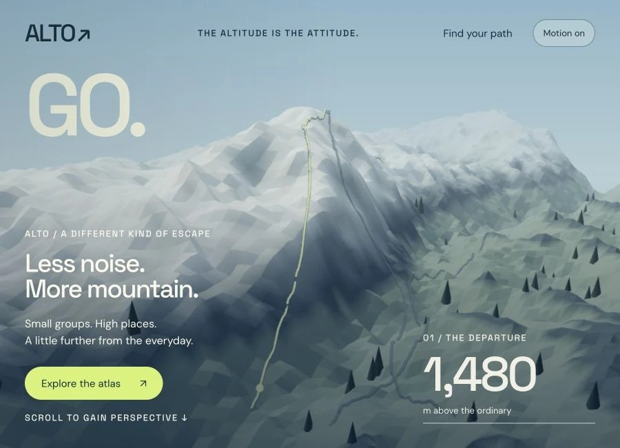
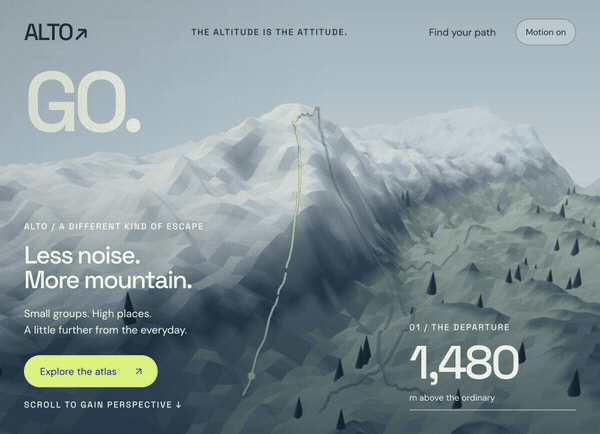
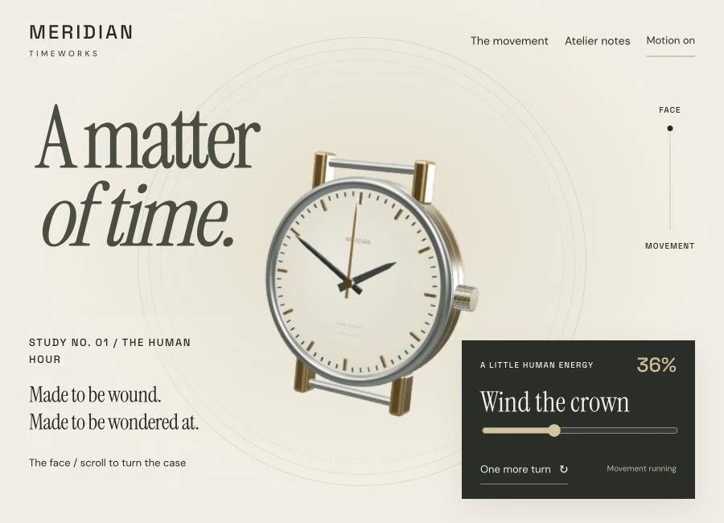
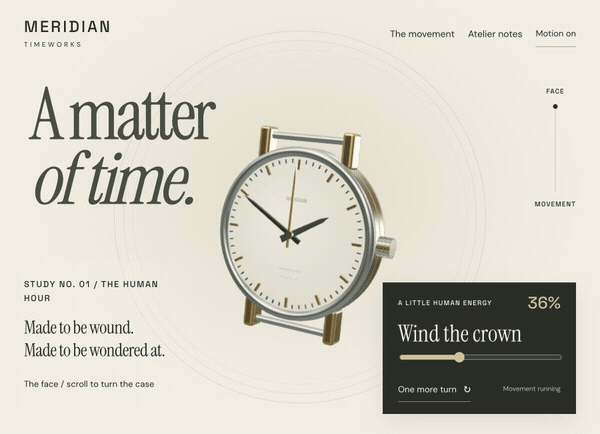
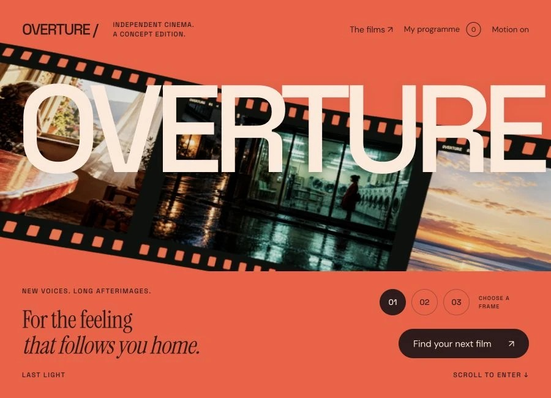
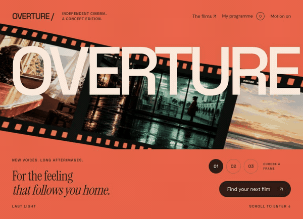
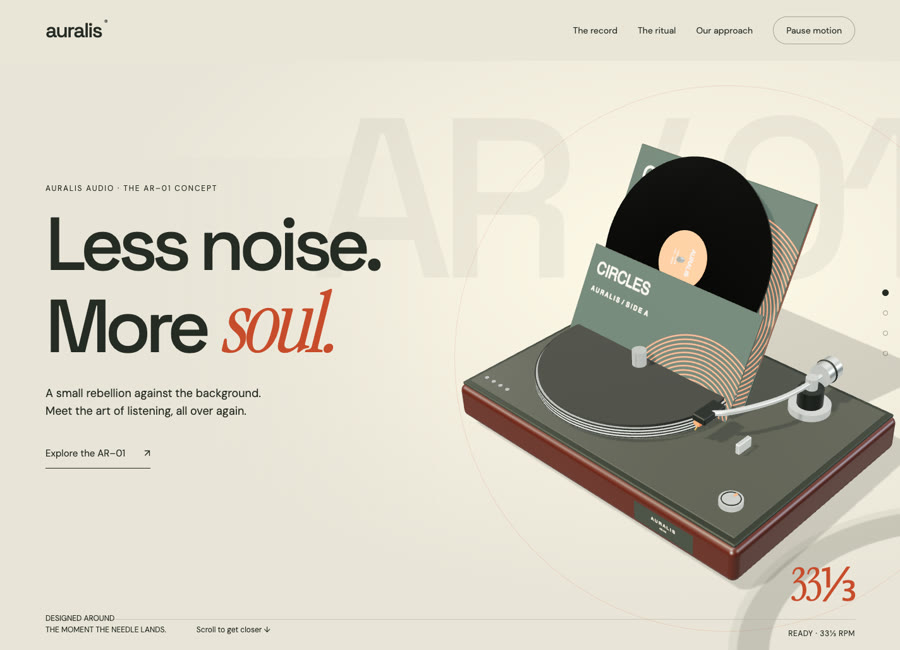
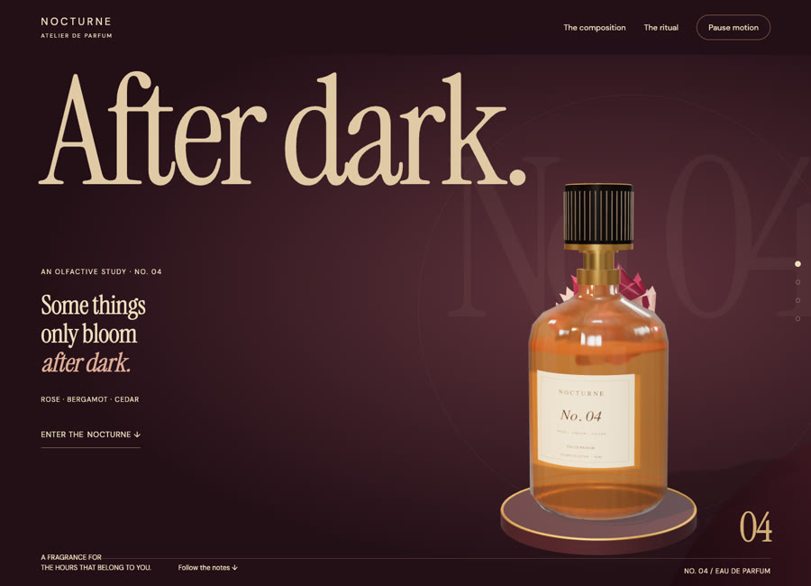
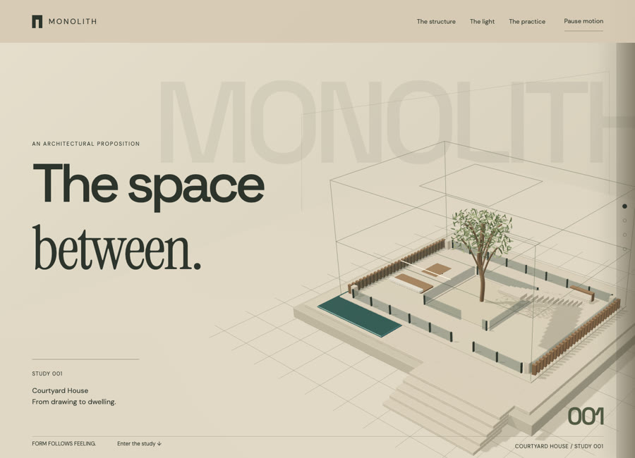

# Web Design Portfolio

Six interactive concept websites exploring travel, watchmaking, cinema, audio, fragrance and architecture.

**[Open the portfolio gallery ↗](https://northlight7.github.io/web-design-portfolio/)** · [GitHub profile](https://github.com/northlight7)

Each project has a still preview, desktop and mobile screenshots, source code and a public live site. Three of them also have an animated scroll preview. No account or download is needed to visit.

## ALTO Expeditions

**Travel & adventure** · Independent concept

An alpine journey that climbs through a mountain landscape before opening into an interactive route atlas.

Play animated scroll preview (7 seconds)

**[Visit the live site ↗](https://northlight7.github.io/cinematic-alto/)** · [Project notes & screenshots](projects/alto/) · [Source code](https://github.com/northlight7/cinematic-alto)

## MERIDIAN Timeworks

**Watchmaking & luxury** · Independent concept

A watchmaking study that turns a complete timepiece to reveal its mechanical reverse, then invites you to wind it.

Play animated scroll preview (7 seconds)

**[Visit the live site ↗](https://northlight7.github.io/cinematic-meridian/)** · [Project notes & screenshots](projects/meridian/) · [Source code](https://github.com/northlight7/cinematic-meridian)

## OVERTURE Film Festival

**Film & culture** · Independent concept

A curved filmstrip unfurls into a cinema screen, leading into a programme you can explore and save.

Play animated scroll preview (7 seconds)

**[Visit the live site ↗](https://northlight7.github.io/cinematic-overture/)** · [Project notes & screenshots](projects/overture/) · [Source code](https://github.com/northlight7/cinematic-overture)

## Auralis Audio

**Audio & object design** · Independent concept

A turntable concept where the record lifts out of its sleeve and settles onto the spindle, then waits for the needle.

**[Visit the live site ↗](https://northlight7.github.io/cinematic-auralis/)** · [Project notes & screenshots](projects/auralis/) · [Source code](https://github.com/northlight7/cinematic-auralis)

## Nocturne Atelier

**Fragrance & luxury** · Independent concept

A fragrance study that opens a night bloom around a portrait bottle and turns each note into a change of light.

**[Visit the live site ↗](https://northlight7.github.io/cinematic-nocturne/)** · [Project notes & screenshots](projects/nocturne/) · [Source code](https://github.com/northlight7/cinematic-nocturne)

## Monolith Architecture

**Architecture & interiors** · Independent concept

A courtyard house that grows out of its own dimensional drawing, then lets you set the daylight and walk inside.

**[Visit the live site ↗](https://northlight7.github.io/cinematic-monolith/)** · [Project notes & screenshots](projects/monolith/) · [Source code](https://github.com/northlight7/cinematic-monolith)

## About the collection

Created through AI-assisted design and development, iterative art direction and browser testing. These are fictional concept projects, with no client affiliation or commercial results claimed.

The animated previews condense actual browser scroll walkthroughs into short silent loops. All six galleries provide still images, and the project folders include mobile screenshots.

The gallery and every demo are static sites hosted on GitHub Pages, with no login, no paid service and no runtime dependency on any AI product. Each demo is buildless and can be served by any local static HTTP server.
