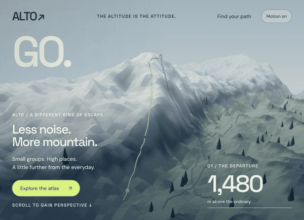
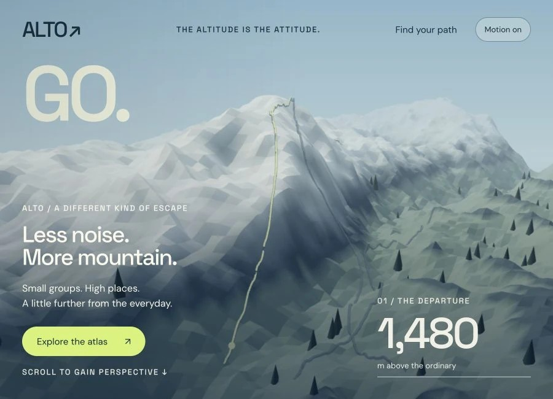
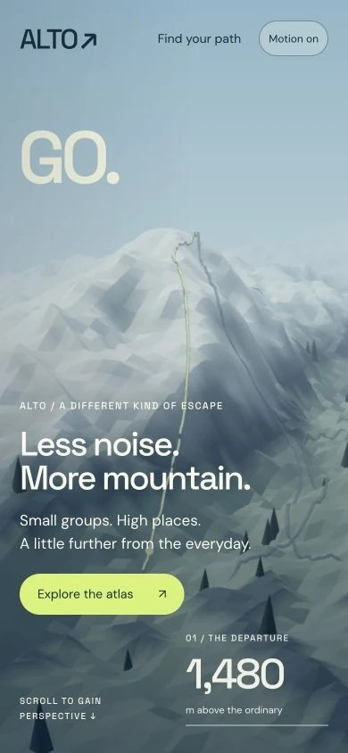

# ALTO Expeditions

Travel & adventure · Independent concept demo

An alpine journey that climbs through a mountain landscape before opening into an interactive route atlas.

**[Visit the live site ↗](https://northlight7.github.io/cinematic-alto/)** · [View source code](https://github.com/northlight7/cinematic-alto) · [Back to portfolio](../../)

Play animated scroll preview (7 seconds)

## The design idea

A continuous camera ascent brings depth to the terrain. The landscape resolves into a route atlas instead of moving from side to side.

## What to try

Scroll through the ascent, then choose a route to reveal its contour path and field notes.

Three routes reveal matching contour paths and field notes. Hover and keyboard focus stay local to the controls.

## Screenshots

### Desktop

### Mobile

## Implementation

HTML, CSS, JavaScript and Three.js, with locally hosted dependencies and assets. Responsive layouts and motion-off controls support different viewing preferences. Hosted independently on GitHub Pages.

Created through AI-assisted design and development, iterative art direction and browser testing. This is fictional concept work, with no client affiliation or commercial results claimed. The preview condenses an actual browser scroll walkthrough into a short silent loop.

[Open the gallery](https://northlight7.github.io/web-design-portfolio/) · [View all projects](../../)
