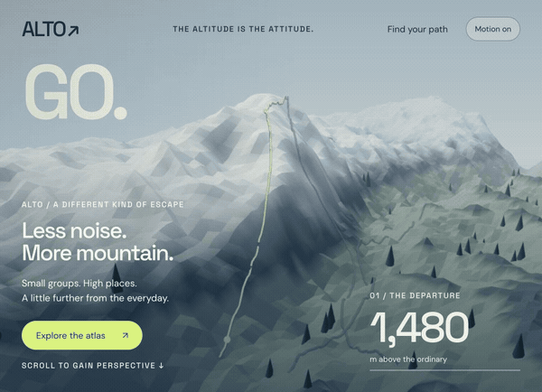
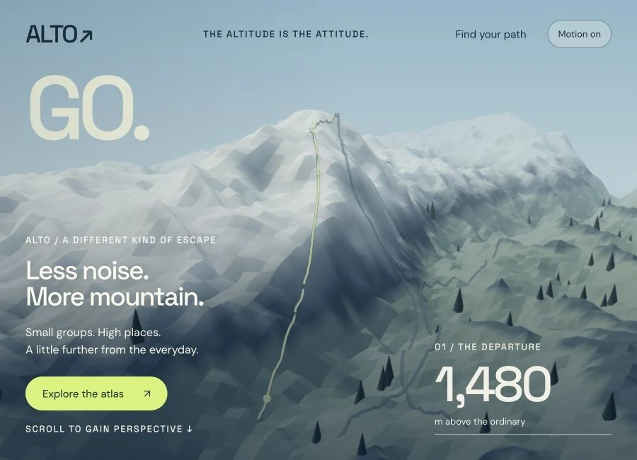
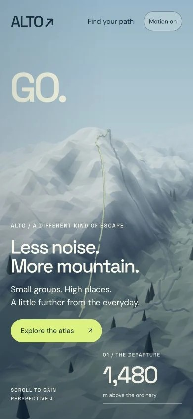

# ALTO Expeditions

Travel & adventure · Independent concept demo

You climb from the valley to the ridge, then pick a route and read its profile against the terrain the scene is built on.

**[Visit the live site ↗](https://northlight7.github.io/cinematic-alto/)** · [Read the code](https://github.com/northlight7/cinematic-alto) · [Back to portfolio](../../)

Play animated scroll preview (7 seconds)

## The design idea

A continuous camera ascent brings depth to the terrain. The landscape resolves into a route atlas instead of moving from side to side.

## What to try

Scroll through the ascent, then choose a route to reveal its contour path, ascent profile and field notes.

Three routes reveal matching contour paths and ascent profiles sampled from the same terrain the scene is built on.

## Screenshots

### Desktop

### Mobile

## Implementation

HTML, CSS, JavaScript and Three.js, with locally hosted dependencies and assets. Responsive layouts and motion-off controls support different viewing preferences. Hosted independently on GitHub Pages.

Designed, written and built by northlight7. This is fictional concept work, with no client affiliation or commercial results claimed.

[Open the gallery](https://northlight7.github.io/web-design-portfolio/) · [View all projects](../../)
