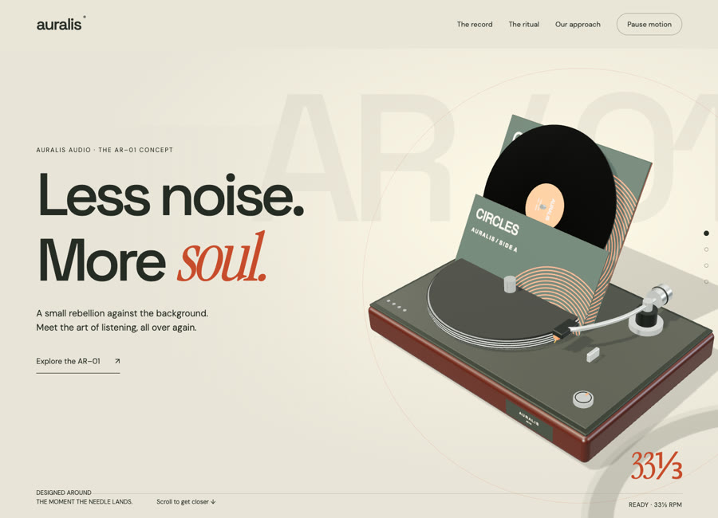
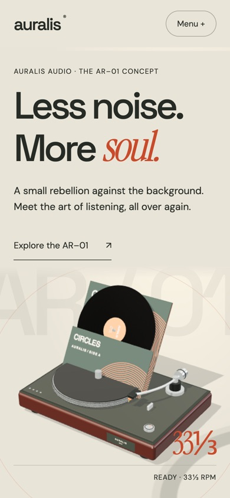

# Auralis Audio

Audio & object design · Independent concept demo

A turntable concept where the record lifts out of its sleeve and settles onto the spindle, then waits for the needle.

**[Visit the live site ↗](https://northlight7.github.io/cinematic-auralis/)** · [View source code](https://github.com/northlight7/cinematic-auralis) · [Back to portfolio](../../)

## The design idea

The record travels from jacket to spindle before the tonearm lowers. The cap, platter and arm are one continuous camera move rather than a set of separate scenes.

## What to try

Scroll to the ritual, pick a finish, then drop the needle and watch the transport start counting.

Three finishes change the plinth material. Drop the needle to start the transport readout, and stop it again.

## Screenshots

### Desktop

### Mobile

## Implementation

HTML, CSS, JavaScript and Three.js, with locally hosted dependencies and assets. Responsive layouts and motion-off controls support different viewing preferences. Hosted independently on GitHub Pages.

Created through AI-assisted design and development, iterative art direction and browser testing. This is fictional concept work, with no client affiliation or commercial results claimed.

[Open the gallery](https://northlight7.github.io/web-design-portfolio/) · [View all projects](../../)
