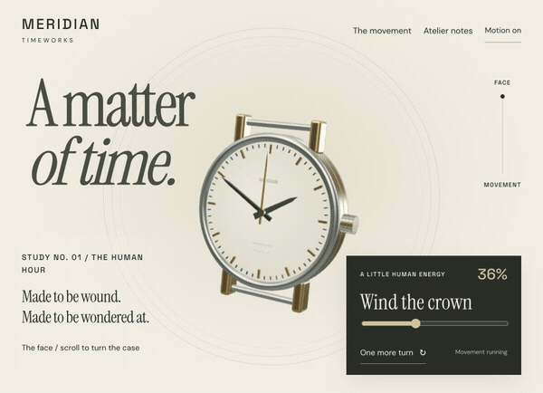
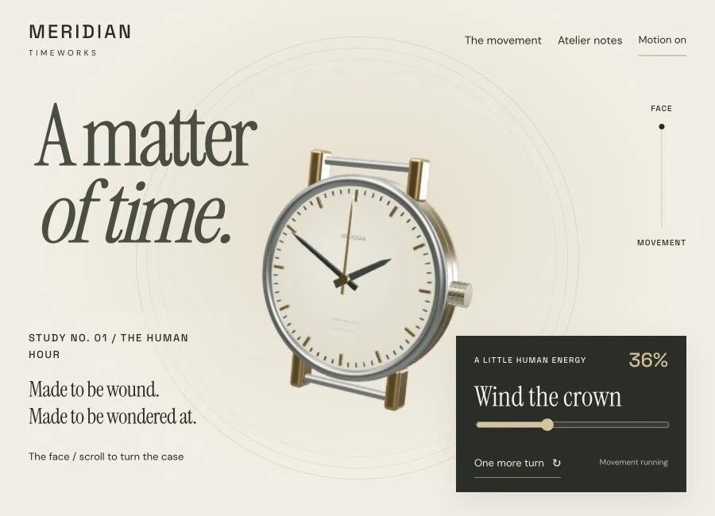
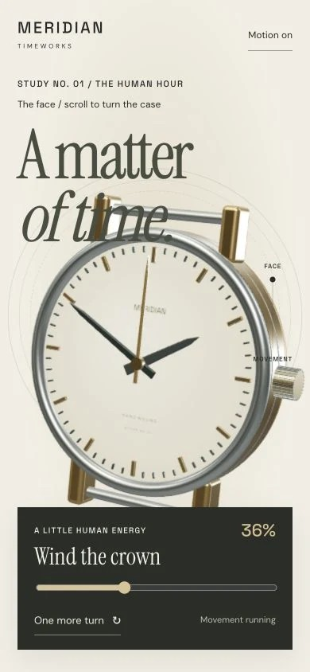

# MERIDIAN Timeworks

Watchmaking & luxury · Independent concept demo

The timepiece turns over in your hand to show its movement, then waits for you to wind it.

**[Visit the live site ↗](https://northlight7.github.io/cinematic-meridian/)** · [Read the code](https://github.com/northlight7/cinematic-meridian) · [Back to portfolio](../../)

Play animated scroll preview (7 seconds)

## The design idea

The timepiece turns as one complete object, showing the leather inside of the strap as it goes. Its front-to-back reveal follows the mechanics of a watch.

## What to try

Scroll to the movement, wind the crown or use its slider, then switch between brass and steel.

Wind with the crown, slider or one-turn button. Switch the movement finish between brass and steel.

## Screenshots

### Desktop

### Mobile

## Implementation

HTML, CSS, JavaScript and Three.js, with locally hosted dependencies and assets. Responsive layouts and motion-off controls support different viewing preferences. Hosted independently on GitHub Pages.

Designed, written and built by northlight7. This is fictional concept work, with no client affiliation or commercial results claimed.

[Open the gallery](https://northlight7.github.io/web-design-portfolio/) · [View all projects](../../)
