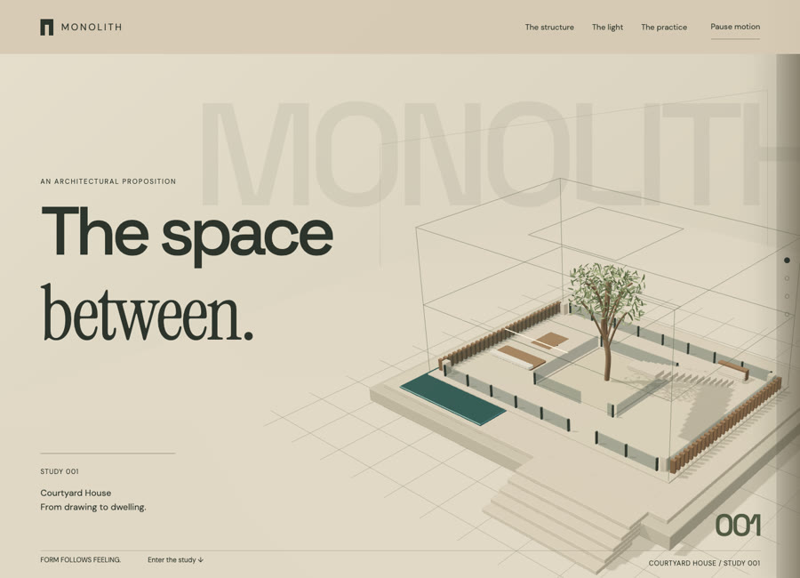
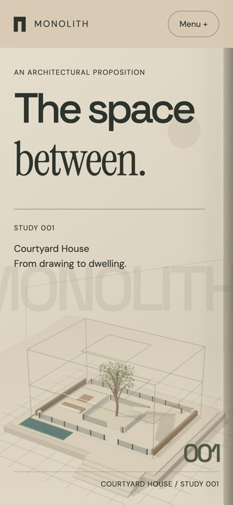

# Monolith Architecture

Architecture & interiors · Independent concept demo

A courtyard house that grows out of its own dimensional drawing, then lets you set the daylight and walk inside.

**[Visit the live site ↗](https://northlight7.github.io/cinematic-monolith/)** · [View source code](https://github.com/northlight7/cinematic-monolith) · [Back to portfolio](../../)

## The design idea

The drawing and the building are the same object at different densities, so the model never has to cut away to a different illustration.

## What to try

Move the daylight slider from morning to golden hour, then follow the camera into the courtyard.

A daylight control moves the shadows across the walls, louvers and water. The camera continues into the courtyard.

## Screenshots

### Desktop

### Mobile

## Implementation

HTML, CSS, JavaScript and Three.js, with locally hosted dependencies and assets. Responsive layouts and motion-off controls support different viewing preferences. Hosted independently on GitHub Pages.

Created through AI-assisted design and development, iterative art direction and browser testing. This is fictional concept work, with no client affiliation or commercial results claimed.

[Open the gallery](https://northlight7.github.io/web-design-portfolio/) · [View all projects](../../)
