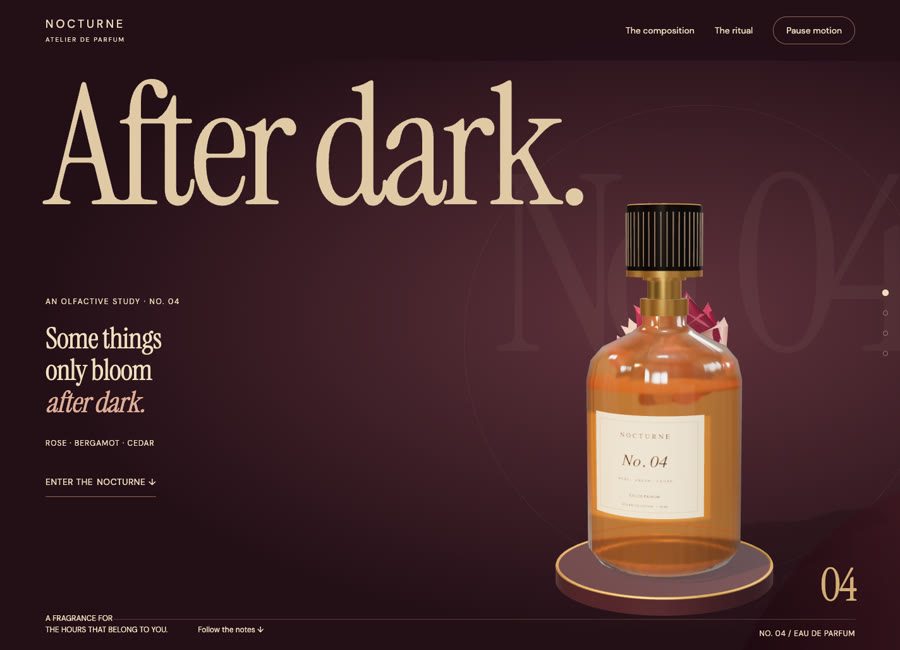
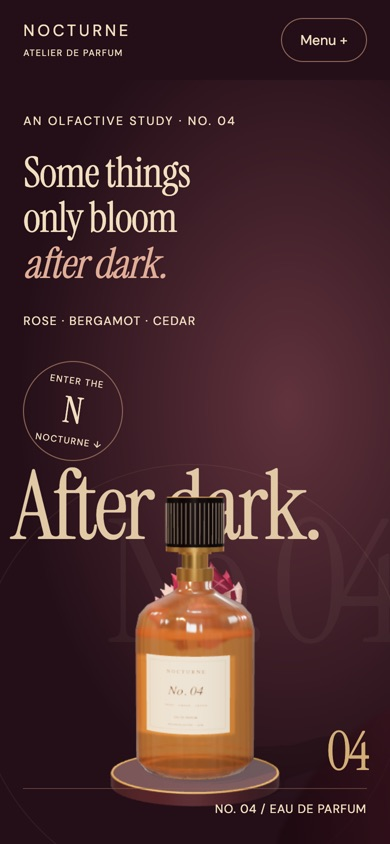

# Nocturne Atelier

Fragrance & luxury · Independent concept demo

A fragrance study that opens a night bloom around a portrait bottle and turns each note into a change of light.

**[Visit the live site ↗](https://northlight7.github.io/cinematic-nocturne/)** · [View source code](https://github.com/northlight7/cinematic-nocturne) · [Back to portfolio](../../)

## The design idea

The cap lifts off and is set down on the plate as the bloom opens around the bottle, instead of a colour swatch swapping.

## What to try

Scroll to the composition, then move between rose, bergamot and cedar to change the atmosphere around the bottle.

Each note restages the petals and the light around the bottle. The cap always ends inside the frame.

## Screenshots

### Desktop

### Mobile

## Implementation

HTML, CSS, JavaScript and Three.js, with locally hosted dependencies and assets. Responsive layouts and motion-off controls support different viewing preferences. Hosted independently on GitHub Pages.

Created through AI-assisted design and development, iterative art direction and browser testing. This is fictional concept work, with no client affiliation or commercial results claimed.

[Open the gallery](https://northlight7.github.io/web-design-portfolio/) · [View all projects](../../)
